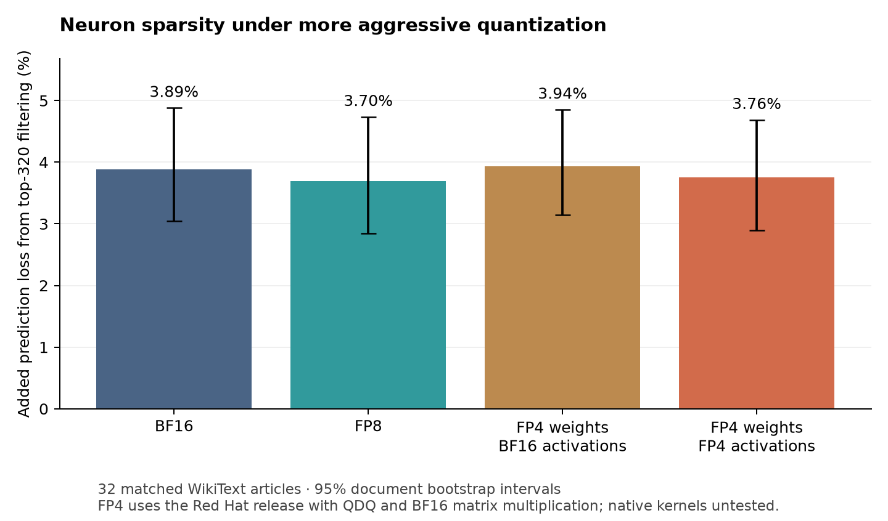

# Released NVFP4 reference pilot

The sparse-computation finding survives this small 4-bit reference test. Keeping
320 of 4,096 routed neuron activations adds 3.76% prediction loss, compared with
3.89% in BF16 and 3.70% in the previous FP8 run. This does **not** establish that
neuron meanings are preserved, or that native FP4 kernels produce the same results.

The checkpoint is [RedHatAI/Qwen3.6-35B-A3B-NVFP4](https://huggingface.co/RedHatAI/Qwen3.6-35B-A3B-NVFP4/tree/e94a930c8e9b8a7d3763e449289c261c9c7d3e5e),
a Red Hat release rather than an official Qwen quantization. No new weight
quantization, calibration, optimization or training was performed.

## Prediction and sparsity results

All conditions use the exact same 32 WikiText-2 test articles, 512 input tokens
per article and 16,352 scored next-token predictions. Lower loss and KL are better.
Loss is cross entropy in nats/token; percentages describe this metric, not accuracy.

| Execution | Unmasked loss | Top-320 loss | Added loss | KL from own unmasked model |
| --- | ---: | ---: | ---: | ---: |
| BF16 | 2.128447 | 2.211191 | 3.89% | 0.166389 |
| FP8 (prior run) | 2.133290 | 2.212129 | 3.70% | 0.168153 |
| FP4 weights / BF16 activations (reference control) | 2.149797 | 2.234421 | 3.94% | 0.167610 |
| FP4 weights / FP4 activations (reference) | 2.168015 | 2.249446 | 3.76% | 0.200734 |

The full FP4 reference starts with 1.86% higher unmasked loss than BF16
(+0.03957 nats/token; paired document bootstrap 95% interval [0.03048, 0.04908]).
Its pruning overhead has a 95% interval of [2.89%, 4.68%]. The difference from
BF16 is -0.13 percentage points, interval [-0.70, +0.45]; this pilot does not
resolve a difference in pruning sensitivity. These are sampling intervals,
not uncertainty estimates for the execution adapter or quantization recipe.

The weight-only diagnostic control omits activation rounding while retaining
the same released weight values. Activation rounding adds 0.01822 nats/token
of unmasked loss, interval [0.01152, 0.02486]. The larger pruning KL with activation
rounding shows that similar loss penalties do not imply identical output distributions.



## BF16 mask transfer

This transfers neuron **identities**, using the FP4 model's own activations.
The FP4 clean expert routes and router weights are frozen for all three controls.
BF16 clean top-320 masks are intersected with available FP4 routes. Each native
and random control keeps exactly the same per-token/per-layer count m. Native
masks use the first m entries of FP4 clean top-320 rankings, rather than
reselecting adaptively after earlier interventions.

97.64% of selected BF16 identities remain available: mean m = 312.449 of 320.
All additions below are measured against the FP4 reference unmasked baseline.

| Mask under frozen routing | Added loss (nats/token) | KL (nats/token) |
| --- | ---: | ---: |
| BF16-transferred mask | 0.047597 | 0.143079 |
| FP4 clean top-m mask | 0.056270 | 0.129466 |
| Random-m mask | 2.852368 | 3.005643 |

Transferred masks remain useful compared with random masks. They have slightly
lower loss than native masks (-0.00867 nats/token, paired 95% interval
[-0.01530, -0.00208]), but higher KL (+0.01361, interval [0.01035, 0.01753]).
This metric-dependent result resembles the previous FP8 follow-up; it does not
justify declaring one mask universally better.

## Execution and validation

`nvfp4_reference.py` decodes the published E2M1 packed weights and stored scales
with compressed-tensors 0.20.1. It reproduces the checkpoint's locally dynamic
FP4 activation quantize/dequantize scheme, including the stored global scale
for each expert/projection. Selected attention and shared-expert linear layers
follow the release's recipe too. Routers, embeddings, LM head and linear-attention
components remain at higher precision as specified by the release. Shared-expert
neuron activations are never pruned. The checkpoint omits its unused vision tower;
all experiments use text only, with every required text parameter checked.

**Matrix multiplications run in BF16.** Dequantizing operands to BF16 before
multiplication can differ from scale handling and accumulation in native FP4
kernels. This is a reference quantization experiment, not native FP4 inference,
and supplies no evidence about deployment memory or speed savings.

Validation saved in the preflight and verification files establishes:

- An actual released expert decodes identically to the official compressor on CPU.
- GPU random packed-weight decompression matches the official compressor exactly.
- Vectorized GPU activation rounding matches official per-row calls exactly on
  validation inputs, including an all-zero activation row.
- The custom MoE indexing and reduction match unmodified BF16 grouped execution
  bitwise when activation rounding is disabled.
- Instrumentation and keep-all masks preserve logits bitwise in both precisions.
- Every BF16 document loss, both unmasked and pruned, matches the previous run exactly.

These checks do not establish native FP4 kernel parity. No new semantic judgment
experiment was run. Corpus size, short Wikipedia contexts, changed calibration
recipe and reference arithmetic limit generalization and direct replication of
Goodfire's full study. The publisher provides a creation script using 256
UltraChat samples of up to 4,096 tokens, but does not pin every creation dependency;
our run uses its pinned existing checkpoint rather than recreating calibration.

## Reproduce

The recorded runtime used `pytorch/pytorch:2.10.0-cuda12.8-cudnn9-runtime` on
one 96 GB RTX Pro 6000. The reference method expands weights into BF16, so it
still needs this memory even though the downloaded checkpoint is compressed.
Exact revisions, quantization arguments, masks, sampling and metric definitions
are saved in `protocol.json` and `RedHatAI_config.json`.

```bash
# In the recorded GPU runtime, from this directory:
bash setup.sh

# Recreate analysis and the plot with no GPU, from the repository root:
python -m pip install -r requirements-analysis.txt
python fp4/analyze.py
python fp4/plot.py
```

The setup regenerates the exact public input sample and verifies its hash before
running BF16 and FP4. It pins Transformers and compressed-tensors. Large reference
logits, model weights, raw passages, credentials and rental controls are excluded.
The result-producing source commit was
`9510afe1fea0ad49fab1c31e043740ef715371b8`; later additions contain analysis and reports.
All task rentals were destroyed. Reported cumulative Vast charges were $2.223,
including previous experiments, against the original $6 cap (`spend.json`).
